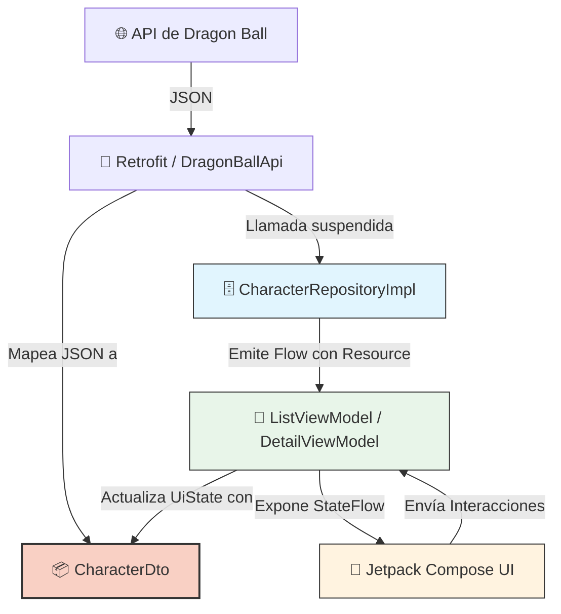

# 🐉 Capítulo 15: Habla con tu API usando Retrofit (Enfoque Directo)

---

## 🎯 Objetivo

Crear una aplicación Android que muestre personajes de Dragon Ball, permita buscarlos mediante filtros y navegar a una pantalla de detalle, utilizando un enfoque pragmático donde la UI consume directamente los **Data Transfer Objects (DTOs)** obtenidos desde el Repositorio, sin capas intermedias de Casos de Uso.


### 🗺️ Diagrama de Arquitectura (Enfoque Directo)

Este diagrama ilustra cómo fluyen los datos en este enfoque simplificado. Nota cómo el `CharacterDto` (en rojo) viaja desde la capa de red hasta la interfaz gráfica.



---

## 🪜 Paso 1: Crear el Proyecto

1. Crear un proyecto Android con **Empty Compose Activity**.
2. Ejecutar la aplicación para verificar que funcione correctamente.

---

## 🌍 Paso 2: Permiso de Internet

Agregar el permiso de internet en el archivo `AndroidManifest.xml`.

```xml
<uses-permission android:name="android.permission.INTERNET" />
```

---

## 📦 Paso 3: Dependencias

Agregar estas dependencias en el archivo `build.gradle.kts (Module :app)`.

```kotlin
// Retrofit y Moshi
implementation(libs.retrofit)
implementation(libs.retrofit2.kotlinx.serialization.converter)
implementation(libs.kotlinx.serialization.json)
implementation(libs.squareup.moshi.kotlin)
implementation(libs.converter.moshi)

// Hilt (Asumiendo que lo estás usando para Inyección de Dependencias)
implementation(libs.hilt.android)
kapt(libs.hilt.android.compiler)
```

Y agregar estas en el archivo `libs.versions.toml`:

```toml
[versions]
kotlinSerializationJson = "1.10.0"
retrofit2KotlinxSerializationConverter = "1.0.0"
retrofit = "2.9.0"
moshiKotlin = "1.15.0"
converterMoshi = "2.9.0"

[libraries]
retrofit = { module = "com.squareup.retrofit2:retrofit", version.ref = "retrofit" }
retrofit2-kotlinx-serialization-converter = { module = "com.jakewharton.retrofit:retrofit2-kotlinx-serialization-converter", version.ref = "retrofit2KotlinxSerializationConverter" }
kotlinx-serialization-json = { module = "org.jetbrains.kotlinx:kotlinx-serialization-json", version.ref = "kotlinSerializationJson" }
converter-moshi = { module = "com.squareup.retrofit2:converter-moshi", version.ref = "converterMoshi" }
squareup-moshi-kotlin = { module = "com.squareup.moshi:moshi-kotlin", version.ref = "moshiKotlin" }
```

---

## 💉 Paso 4: Configuración de Inyección de Dependencias (Hilt)

Configuramos cómo se proveerán Retrofit y nuestro Repositorio.

`di/AppModule.kt`
```kotlin
@Module
@InstallIn(SingletonComponent::class)
object AppModule {

    @Singleton
    @Provides
    fun provideMoshi(): Moshi {
        return Moshi
            .Builder()
            .add(KotlinJsonAdapterFactory())
            .build()
    }

    @Provides
    @Singleton
    fun provideApi(moshi: Moshi): DragonBallApi {
        return Retrofit.Builder()
            .baseUrl("https://dragonball-api.com/api/")
            .addConverterFactory(MoshiConverterFactory.create(moshi))
            .build()
            .create(DragonBallApi::class.java)
    }

    @Provides
    @Singleton
    fun provideRepository(api: DragonBallApi): CharacterRepository {
        return CharacterRepositoryImpl(api)
    }
}
```

---

## 🔄 Paso 5: Estados de Carga (Resource)

Clase genérica para envolver las respuestas de red y manejar los estados de éxito, error y carga.

`data/remote/Resource.kt`
```kotlin
sealed class Resource<T>(
    val data: T? = null,
    val message: String? = null
) {
    class Success<T>(data: T) : Resource<T>(data)
    class Error<T>(message: String) : Resource<T>(null, message)
    class Loading<T> : Resource<T>()
}
```

---

## 🧾 Paso 6: DTOs (Data Transfer Objects)

Clases que representan exactamente la respuesta JSON de la API. En este enfoque, **no creamos mapeadores (`toDomain`)**. Usaremos estas clases directamente en la UI.

`data/remote/dto/CharacterResponseDto.kt`
```kotlin
data class CharacterResponseDto(
    val items: List<CharacterDto>
)

data class CharacterDto(
    val id: Int,
    val name: String,
    val ki: String,
    val race: String,
    val gender: String,
    val description: String,
    val image: String,
    val maxKi: String
)
```

---

## 📡 Paso 7: Interfaz de la API

Definimos los endpoints para obtener los datos.

`data/remote/DragonBallApi.kt`
```kotlin
import retrofit2.Response
import retrofit2.http.GET
import retrofit2.http.Path
import retrofit2.http.Query

interface DragonBallApi {

    @GET("characters")
    suspend fun getCharacters(
        @Query("page") page: Int,
        @Query("limit") limit: Int,
        @Query("name") name: String?,
        @Query("gender") gender: String?,
        @Query("race") race: String?
    ): Response<CharacterResponseDto>

    @GET("characters/{id}")
    suspend fun getCharacterDetail(
        @Path("id") id: Int
    ): Response<CharacterDto>
}
```

---

## 🗄️ Paso 8: Repositorio (Interfaz e Implementación)

El repositorio se encarga de llamar a la API y devolver un `Flow` con el estado (`Resource`) y los **DTOs directamente**.

`data/repository/CharacterRepository.kt`
```kotlin
import kotlinx.coroutines.flow.Flow

interface CharacterRepository {
    fun getCharacters(
        page: Int = 1,
        limit: Int = 10,
        name: String? = null,   
        gender: String? = null, 
        race: String? = null,    
    ): Flow<Resource<List<CharacterDto>>>

    fun getCharacterDetail(id: Int): Flow<Resource<CharacterDto>>
}
```

`data/repository/CharacterRepositoryImpl.kt`
```kotlin
import kotlinx.coroutines.flow.Flow
import kotlinx.coroutines.flow.flow
import javax.inject.Inject

class CharacterRepositoryImpl @Inject constructor(
    private val api: DragonBallApi
) : CharacterRepository {

    override fun getCharacters(
        page: Int,
        limit: Int,
        name: String?,
        gender: String?,
        race: String?
    ): Flow<Resource<List<CharacterDto>>> = flow {
        emit(Resource.Loading())
        try {
            val response = api.getCharacters(page, limit, name, gender, race)
            if (response.isSuccessful && response.body() != null) {
                // Devolvemos la lista de DTOs directamente
                emit(Resource.Success(response.body()!!.items))
            } else {
                emit(Resource.Error("Error de red: ${response.code()}"))
            }
        } catch (e: Exception) {
            emit(Resource.Error(e.message ?: "Error desconocido"))
        }
    }

    override fun getCharacterDetail(id: Int): Flow<Resource<CharacterDto>> = flow {
        emit(Resource.Loading())
        try {
            val response = api.getCharacterDetail(id)
            if (response.isSuccessful && response.body() != null) {
                // Devolvemos el DTO directamente
                emit(Resource.Success(response.body()!!))
            } else {
                emit(Resource.Error("Error de red: ${response.code()}"))
            }
        } catch (e: Exception) {
            emit(Resource.Error(e.message ?: "Error desconocido"))
        }
    }
}
```

---

## 🧠 Paso 9: Estado de la Pantalla de Lista

Nuestra UI almacenará directamente una lista de `CharacterDto`.

`presentation/list/ListUiState.kt`
```kotlin
data class ListUiState(
    val isLoading: Boolean = false,
    val characters: List<CharacterDto> = emptyList(), // Usando DTO
    val error: String? = null,
    val filterName: String = "",
    val filterGender: String = "",
    val filterRace: String = ""
)
```

---

## 🎯 Paso 10: Eventos de la Pantalla

`presentation/list/ListEvent.kt`
```kotlin
sealed interface ListEvent {
    data class UpdateFilters(
        val name: String,
        val gender: String,
        val race: String
    ) : ListEvent

    data object Search : ListEvent
}
```

---

## 🕹️ Paso 11: ViewModel de Lista

El ViewModel inyecta el `CharacterRepository` **directamente** (saltándose el Use Case) y consume el Flow.

`presentation/list/ListViewModel.kt`
```kotlin
import androidx.lifecycle.ViewModel
import androidx.lifecycle.viewModelScope
import dagger.hilt.android.lifecycle.HiltViewModel
import kotlinx.coroutines.flow.*
import kotlinx.coroutines.launch
import javax.inject.Inject

@HiltViewModel
class ListViewModel @Inject constructor(
    private val repository: CharacterRepository // Inyección directa del repo
) : ViewModel() {

    private val _state = MutableStateFlow(ListUiState())
    val state = _state.asStateFlow()

    init {
        loadCharacters()
    }

    fun onEvent(event: ListEvent) {
        when (event) {
            is ListEvent.UpdateFilters -> _state.update {
                it.copy(
                    filterName = event.name,
                    filterGender = event.gender,
                    filterRace = event.race
                )
            }
            ListEvent.Search -> loadCharacters()
        }
    }

    private fun loadCharacters() {
        viewModelScope.launch {
            val current = _state.value

            // Llamada directa al repositorio
            repository.getCharacters(
                name = current.filterName.takeIf { it.isNotBlank() },
                gender = current.filterGender.takeIf { it.isNotBlank() },
                race = current.filterRace.takeIf { it.isNotBlank() }
            ).collect { result ->
                when (result) {
                    is Resource.Loading -> _state.update { it.copy(isLoading = true) }
                    is Resource.Success -> _state.update {
                        it.copy(
                            isLoading = false,
                            characters = result.data ?: emptyList()
                        )
                    }
                    is Resource.Error -> _state.update {
                        it.copy(
                            isLoading = false,
                            error = result.message
                        )
                    }
                }
            }
        }
    }
}
```

---

## 🎨 Paso 12: Screen de Lista y Componente Item

La UI pinta la información accediendo a los campos del `CharacterDto`.

`presentation/list/ListScreen.kt`
```kotlin
import androidx.compose.foundation.clickable
import androidx.compose.foundation.layout.*
import androidx.compose.foundation.lazy.LazyColumn
import androidx.compose.foundation.lazy.items
import androidx.compose.material3.*
import androidx.compose.runtime.*
import androidx.compose.ui.Alignment
import androidx.compose.ui.Modifier
import androidx.compose.ui.unit.dp
import androidx.hilt.navigation.compose.hiltViewModel
import androidx.lifecycle.compose.collectAsStateWithLifecycle
import coil.compose.AsyncImage

@OptIn(ExperimentalMaterial3Api::class)
@Composable
fun ListScreen(
    viewModel: ListViewModel = hiltViewModel(),
    onCharacterClick: (Int) -> Unit
) {
    val state by viewModel.state.collectAsStateWithLifecycle()
    ListBodyScreen(
        state = state,
        onEvent = viewModel::onEvent,
        onCharacterClick = onCharacterClick
    )
}

@OptIn(ExperimentalMaterial3Api::class)
@Composable
fun ListBodyScreen(
    state: ListUiState,
    onEvent: (ListEvent) -> Unit,
    onCharacterClick: (Int) -> Unit,
) {
    Scaffold(
        topBar = { CenterAlignedTopAppBar(title = { Text("Dragon Ball App") }) }
    ) { padding ->

        Column(
            modifier = Modifier.padding(padding).fillMaxSize()
        ) {
            FilterSection(
                name = state.filterName,
                gender = state.filterGender,
                race = state.filterRace,
                onEvent = onEvent,
            )

            if (state.isLoading) {
                CircularProgressIndicator(modifier = Modifier.align(Alignment.CenterHorizontally))
            }

            LazyColumn(contentPadding = PaddingValues(16.dp)) {
                items(state.characters) { characterDto ->
                    CharacterItem(
                        character = characterDto,
                        onClick = { onCharacterClick(characterDto.id) }
                    )
                    Spacer(modifier = Modifier.height(8.dp))
                }
            }
        }
    }
}

@Composable
fun CharacterItem(
    character: CharacterDto, // Recibe el DTO
    onClick: () -> Unit
) {
    ElevatedCard(
        modifier = Modifier.fillMaxWidth().clickable { onClick() }
    ) {
        Row(
            modifier = Modifier.padding(16.dp),
            verticalAlignment = Alignment.CenterVertically
        ) {
            AsyncImage(
                model = character.image,
                contentDescription = character.name,
                modifier = Modifier.size(64.dp)
            )
            Spacer(modifier = Modifier.width(16.dp))
            Column {
                Text(character.name, style = MaterialTheme.typography.titleMedium)
                Text("${character.race} • ${character.gender}")
            }
        }
    }
}

@Composable
fun FilterSection(
    name: String,
    gender: String,
    race: String,
    onEvent: (ListEvent) -> Unit,
) {
    ElevatedCard(modifier = Modifier.padding(16.dp).fillMaxWidth()) {
        Column(modifier = Modifier.padding(16.dp), verticalArrangement = Arrangement.spacedBy(8.dp)) {
            OutlinedTextField(
                value = name,
                onValueChange = { onEvent(ListEvent.UpdateFilters(it, gender, race)) },
                label = { Text("Nombre (ej. Goku)") },
                modifier = Modifier.fillMaxWidth()
            )
            Row(horizontalArrangement = Arrangement.spacedBy(8.dp)) {
                OutlinedTextField(
                    value = gender,
                    onValueChange = { onEvent(ListEvent.UpdateFilters(name, it, race)) },
                    label = { Text("Género") },
                    modifier = Modifier.weight(1f)
                )
                OutlinedTextField(
                    value = race,
                    onValueChange = { onEvent(ListEvent.UpdateFilters(name, gender, it)) },
                    label = { Text("Raza") },
                    modifier = Modifier.weight(1f)
                )
            }
            Button(
                onClick = { onEvent(ListEvent.Search) },
                modifier = Modifier.align(Alignment.End)
            ) {
                Text("Buscar")
            }
        }
    }
}
```

---

## 🔍 Paso 13: ViewModel de Detalle

De igual manera, inyectamos el Repositorio directo para el detalle.

`presentation/detail/DetailViewModel.kt`
```kotlin
import androidx.lifecycle.SavedStateHandle
import androidx.lifecycle.ViewModel
import androidx.lifecycle.viewModelScope
import dagger.hilt.android.lifecycle.HiltViewModel
import kotlinx.coroutines.flow.*
import kotlinx.coroutines.launch
import javax.inject.Inject

data class DetailUiState(
    val isLoading: Boolean = false,
    val character: CharacterDto? = null, // Usando DTO
    val error: String? = null
)

@HiltViewModel
class DetailViewModel @Inject constructor(
    private val repository: CharacterRepository, // Inyección directa
    savedStateHandle: SavedStateHandle
) : ViewModel() {

    private val _state = MutableStateFlow(DetailUiState())
    val state = _state.asStateFlow()

    init {
        // Asegúrate de tener tu clase Screen.Detail definida en la navegación
        // val args = savedStateHandle.toRoute<Screen.Detail>()
        // loadCharacter(args.id)
        
        // Ejemplo de id fijo para la demostración si no tienes configurado Navigation Type-Safe:
        val characterId = savedStateHandle.get<Int>("id") ?: 1
        loadCharacter(characterId)
    }

    private fun loadCharacter(id: Int) {
        viewModelScope.launch {
            repository.getCharacterDetail(id).collect { result ->
                when (result) {
                    is Resource.Loading -> _state.update { it.copy(isLoading = true) }
                    is Resource.Success -> _state.update { it.copy(isLoading = false, character = result.data) }
                    is Resource.Error -> _state.update { it.copy(isLoading = false, error = result.message) }
                }
            }
        }
    }
}
```

---

## 📄 Paso 14: Screen de Detalle

Mostramos el detalle usando la información del `CharacterDto`.

`presentation/detail/DetailScreen.kt`
```kotlin
import androidx.compose.foundation.layout.*
import androidx.compose.material.icons.Icons
import androidx.compose.material.icons.filled.ArrowBack
import androidx.compose.material3.*
import androidx.compose.runtime.Composable
import androidx.compose.ui.Modifier
import androidx.compose.ui.unit.dp
import coil.compose.AsyncImage

@OptIn(ExperimentalMaterial3Api::class)
@Composable
fun DetailScreen(
    state: DetailUiState,
    onBack: () -> Unit
) {
    Scaffold(
        topBar = {
            TopAppBar(
                title = { Text("Detalle del Personaje") },
                navigationIcon = {
                    IconButton(onClick = onBack) {
                        Icon(Icons.Default.ArrowBack, contentDescription = "Volver")
                    }
                }
            )
        }
    ) { padding ->

        if (state.isLoading) {
            CircularProgressIndicator()
        }

        state.character?.let { character ->
            Column(
                modifier = Modifier
                    .padding(padding)
                    .padding(16.dp)
            ) {
                AsyncImage(
                    model = character.image,
                    contentDescription = character.name,
                    modifier = Modifier
                        .fillMaxWidth()
                        .height(240.dp)
                )
                Spacer(modifier = Modifier.height(16.dp))
                Text(text = character.name, style = MaterialTheme.typography.headlineMedium)
                Text(text = "Raza: ${character.race}", style = MaterialTheme.typography.bodyLarge)
                Text(text = "Género: ${character.gender}", style = MaterialTheme.typography.bodyLarge)
                Text(text = "Ki Base: ${character.ki}", style = MaterialTheme.typography.bodyLarge)
                Text(text = "Ki Máximo: ${character.maxKi}", style = MaterialTheme.typography.bodyLarge)
                Spacer(modifier = Modifier.height(16.dp))
                Text(text = character.description, style = MaterialTheme.typography.bodyMedium)
            }
        }
    }
}
```

---
---

# 🧪 Capítulo 16: Testing (Capa de Datos)

A continuación, prepararemos el entorno para realizar pruebas unitarias y de instrumentación en nuestra aplicación, y crearemos los tests para asegurar que nuestra capa de datos (Repositorio) funcione correctamente.

---

## 📦 Dependencias de Testing

Agrega estas dependencias en tu archivo `build.gradle.kts` (Module: app) para habilitar JUnit, MockK, Coroutines Testing, Espresso, Hilt y Room Testing.

```kotlin
dependencies {
    // Unit Testing
    testImplementation("junit:junit:4.13.2")
    testImplementation("org.jetbrains.kotlinx:kotlinx-coroutines-test:1.7.3")
    testImplementation("io.mockk:mockk:1.13.8")
    testImplementation("androidx.arch.core:core-testing:2.2.0")
    
    // Android Instrumented Testing
    androidTestImplementation("androidx.test.ext:junit:1.1.5")
    androidTestImplementation("androidx.test.espresso:espresso-core:3.5.1")
    
    // Compose Testing
    androidTestImplementation("androidx.compose.ui:ui-test-junit4:1.5.4")
    debugImplementation("androidx.compose.ui:ui-test-manifest:1.5.4")
    
    // Hilt Testing
    testImplementation("com.google.dagger:hilt-android-testing:2.48")
    kspTest("com.google.dagger:hilt-android-compiler:2.48")
    androidTestImplementation("com.google.dagger:hilt-android-testing:2.48")
    kspAndroidTest("com.google.dagger:hilt-android-compiler:2.48")
    
    // Room Testing
    testImplementation("androidx.room:room-testing:2.6.0")
}
```

---

## 🧩 Tests de Capa de Datos (Repository)

Aquí implementamos las pruebas unitarias para `TaskRepositoryImpl`. Utilizamos **MockK** para simular el comportamiento de nuestro `TaskDao` y verificar que el repositorio transforma y transmite los datos correctamente, sin necesidad de una base de datos real.

`test/java/.../data/repository/TaskRepositoryImplTest.kt`

```kotlin
import androidx.arch.core.executor.testing.InstantTaskExecutorRule
import io.mockk.*
import kotlinx.coroutines.ExperimentalCoroutinesApi
import kotlinx.coroutines.flow.first
import kotlinx.coroutines.flow.flowOf
import kotlinx.coroutines.test.runTest
import org.junit.Assert.*
import org.junit.Before
import org.junit.Rule
import org.junit.Test

@ExperimentalCoroutinesApi
class TaskRepositoryImplTest {

    // Regla necesaria para ejecutar operaciones de arquitectura (como LiveData o Flows) de forma síncrona en los tests
    @get:Rule
    val instantExecutorRule = InstantTaskExecutorRule()

    private lateinit var repository: TaskRepositoryImpl
    private lateinit var dao: TaskDao

    @Before
    fun setup() {
        // Creamos un mock "relajado" del DAO. Esto significa que si llamamos a un método
        // que no hemos configurado explícitamente, no lanzará error, sino que devolverá valores por defecto.
        dao = mockk(relaxed = true)
        repository = TaskRepositoryImpl(dao)
    }

    @Test
    fun `upsert guarda tarea correctamente`() = runTest {
        // Given (Dado)
        val task = Task(
            tareaId = 0,
            descripcion = "Nueva tarea",
            tiempo = 30
        )
        // Capturamos el argumento que se le pasa al DAO para verificar su contenido
        val taskSlot = slot<TaskEntity>()
        coEvery { dao.upsert(capture(taskSlot)) } just Runs

        // When (Cuando)
        val result = repository.upsert(task)

        // Then (Entonces)
        assertEquals(0, result) // Si tareaId es 0, suele indicar una inserción nueva
        coVerify { dao.upsert(any()) } // Verificamos que se llamó a la función
        assertEquals("Nueva tarea", taskSlot.captured.descripcion)
        assertEquals(30, taskSlot.captured.tiempo)
    }

    @Test
    fun `upsert actualiza tarea correctamente`() = runTest {
        // Given
        val task = Task(tareaId = 1, descripcion = "Tarea actualizada", tiempo = 45)
        coEvery { dao.upsert(any()) } just Runs

        // When
        val result = repository.upsert(task)

        // Then
        assertEquals(1, result) // El ID se mantiene porque ya existía
        coVerify { dao.upsert(any()) }
    }

    @Test
    fun `delete elimina tarea correctamente`() = runTest {
        // Given
        val taskId = 1
        coEvery { dao.deleteById(taskId) } just Runs

        // When
        repository.delete(taskId)

        // Then
        coVerify { dao.deleteById(taskId) } // Verificamos que el DAO recibió la orden de borrado con el ID correcto
    }

    @Test
    fun `observeTasks retorna flow de tareas`() = runTest {
        // Given
        val entities = listOf(
            TaskEntity(1, "Tarea 1", 30),
            TaskEntity(2, "Tarea 2", 45)
        )
        every { dao.observeAll() } returns flowOf(entities)

        // When
        // Consumimos el primer elemento del Flow para probarlo
        val result = repository.observeTasks().first()

        // Then
        assertEquals(2, result.size)
        assertEquals("Tarea 1", result[0].descripcion)
        assertEquals("Tarea 2", result[1].descripcion)
    }

    @Test
    fun `getTask retorna tarea por id`() = runTest {
        // Given
        val entity = TaskEntity(1, "Tarea Test", 30)
        coEvery { dao.getById(1) } returns entity

        // When
        val result = repository.getTask(1)

        // Then
        assertNotNull(result)
        assertEquals("Tarea Test", result?.descripcion)
        assertEquals(30, result?.tiempo)
    }
}
```

---
---

# 🎨 Capítulo 17: Testing (Capa de Presentación y UI)

En este capítulo, aseguraremos que nuestra lógica de presentación (ViewModels) y nuestra Interfaz de Usuario (Jetpack Compose) respondan correctamente a los datos y eventos del usuario.

---

## 🧠 Tests del ViewModel

Para testear el ViewModel, necesitamos simular los Casos de Uso (o el Repositorio, dependiendo de tu arquitectura) y controlar el hilo principal (`Main Dispatcher`) usado por las corrutinas.

Primero, creamos una regla personalizada `MainDispatcherRule` para reemplazar el `Dispatchers.Main` de Android por un `TestDispatcher` durante las pruebas.

`test/java/.../presentation/task/TaskListViewModelTest.kt`
```kotlin
import androidx.arch.core.executor.testing.InstantTaskExecutorRule
import io.mockk.*
import kotlinx.coroutines.Dispatchers
import kotlinx.coroutines.ExperimentalCoroutinesApi
import kotlinx.coroutines.flow.flowOf
import kotlinx.coroutines.test.*
import org.junit.Assert.*
import org.junit.Before
import org.junit.Rule
import org.junit.Test
import org.junit.rules.TestWatcher
import org.junit.runner.Description

@ExperimentalCoroutinesApi
class TaskListViewModelTest {

    // Ejecuta tareas síncronas para LiveData/StateFlow
    @get:Rule
    val instantExecutorRule = InstantTaskExecutorRule()

    // Reemplaza el Main Dispatcher por uno de prueba
    @get:Rule
    val mainDispatcherRule = MainDispatcherRule()

    private lateinit var viewModel: TaskListViewModel
    private lateinit var observeTasksUseCase: ObserveTasksUseCase
    private lateinit var deleteTaskUseCase: DeleteTaskUseCase

    @Before
    fun setup() {
        observeTasksUseCase = mockk()
        deleteTaskUseCase = mockk()
        
        // Comportamiento por defecto para evitar errores al inicializar el ViewModel
        every { observeTasksUseCase() } returns flowOf(emptyList())
        
        viewModel = TaskListViewModel(
            observeTasksUseCase,
            deleteTaskUseCase
        )
    }

    @Test
    fun `loadTasks carga lista de tareas correctamente`() = runTest {
        // Given (Dado)
        val tasks = listOf(
            Task(tareaId = 1, descripcion = "Tarea 1", tiempo = 30),
            Task(tareaId = 2, descripcion = "Tarea 2", tiempo = 45)
        )
        every { observeTasksUseCase() } returns flowOf(tasks)
        
        // When (Cuando)
        // Reiniciamos el ViewModel para que consuma el mock configurado en "Given"
        viewModel = TaskListViewModel(observeTasksUseCase, deleteTaskUseCase)
        advanceUntilIdle() // Espera a que terminen las corrutinas pendientes

        // Then (Entonces)
        assertFalse(viewModel.state.value.isLoading)
        assertEquals(2, viewModel.state.value.tasks.size)
        assertEquals("Tarea 1", viewModel.state.value.tasks[0].descripcion)
    }

    @Test
    fun `onEvent Delete elimina tarea`() = runTest {
        // Given
        val taskId = 1
        coEvery { deleteTaskUseCase(taskId) } just Runs

        // When
        viewModel.onEvent(TaskListUiEvent.Delete(taskId))
        advanceUntilIdle()

        // Then
        coVerify { deleteTaskUseCase(taskId) }
        assertEquals("Eliminado", viewModel.state.value.message)
    }

    @Test
    fun `onEvent CreateNew activa navegacion a crear`() {
        // When
        viewModel.onEvent(TaskListUiEvent.CreateNew)

        // Then
        assertTrue(viewModel.state.value.navigateToCreate)
    }

    @Test
    fun `onEvent Edit activa navegacion a editar con id`() {
        // Given
        val taskId = 5

        // When
        viewModel.onEvent(TaskListUiEvent.Edit(taskId))

        // Then
        assertEquals(taskId, viewModel.state.value.navigateToEditId)
    }

    @Test
    fun `onEvent ClearMessage limpia mensaje`() {
        // Given
        viewModel.onEvent(TaskListUiEvent.ShowMessage("Test message"))

        // When
        viewModel.onEvent(TaskListUiEvent.ClearMessage)

        // Then
        assertNull(viewModel.state.value.message)
    }
}

// Regla para el Dispatcher Main en tests
@ExperimentalCoroutinesApi
class MainDispatcherRule(
    private val testDispatcher: TestDispatcher = UnconfinedTestDispatcher()
) : TestWatcher() {
    override fun starting(description: Description) {
        Dispatchers.setMain(testDispatcher)
    }

    override fun finished(description: Description) {
        Dispatchers.resetMain()
    }
}
```

---

## 📱 Tests de Interfaz de Usuario (Compose UI Testing)

Para las pruebas de UI, utilizaremos `createComposeRule()`. Esto nos permite renderizar nuestros componentes (Composables) de forma aislada e interactuar con ellos buscando nodos por texto, etiquetas (`testTag`), o acciones.

> **Nota:** Estos tests suelen ubicarse en la carpeta `androidTest` (Instrumented Tests), ya que interactúan con el framework de Android.

`androidTest/java/.../presentation/task/TaskListScreenTest.kt`
```kotlin
import androidx.compose.material3.ExperimentalMaterial3Api
import androidx.compose.material3.MaterialTheme
import androidx.compose.ui.test.*
import androidx.compose.ui.test.junit4.createComposeRule
import org.junit.Assert.assertTrue
import org.junit.Rule
import org.junit.Test

@ExperimentalMaterial3Api
class TaskListScreenTest {

    // Regla de Compose necesaria para lanzar y probar la UI
    @get:Rule
    val composeTestRule = createComposeRule()

    @Test
    fun taskListBody_muestra_loading_cuando_isLoading_es_true() {
        // Given
        val state = TaskListUiState(isLoading = true)

        // When
        composeTestRule.setContent {
            MaterialTheme {
                TaskListBody(state = state, onEvent = {}, onNavigateToEdit = {})
            }
        }

        // Then
        // Busca un modificador Modifier.testTag("loading")
        composeTestRule.onNodeWithTag("loading").assertIsDisplayed()
    }

    @Test
    fun taskListBody_muestra_mensaje_vacio_cuando_no_hay_tareas() {
        // Given
        val state = TaskListUiState(isLoading = false, tasks = emptyList())

        // When
        composeTestRule.setContent {
            MaterialTheme {
                TaskListBody(state = state, onEvent = {}, onNavigateToEdit = {})
            }
        }

        // Then
        composeTestRule.onNodeWithTag("empty_message").assertIsDisplayed()
        composeTestRule.onNodeWithText("No hay tareas").assertIsDisplayed()
    }

    @Test
    fun taskListBody_muestra_lista_de_tareas() {
        // Given
        val tasks = listOf(
            Task(tareaId = 1, descripcion = "Tarea 1", tiempo = 30),
            Task(tareaId = 2, descripcion = "Tarea 2", tiempo = 45)
        )
        val state = TaskListUiState(isLoading = false, tasks = tasks)

        // When
        composeTestRule.setContent {
            MaterialTheme {
                TaskListBody(state = state, onEvent = {}, onNavigateToEdit = {})
            }
        }

        // Then
        composeTestRule.onNodeWithText("Tarea 1").assertIsDisplayed()
        composeTestRule.onNodeWithText("Tarea 2").assertIsDisplayed()
    }

    @Test
    fun fab_dispara_evento_CreateNew() {
        // Given
        val state = TaskListUiState(isLoading = false)
        var eventCaptured: TaskListUiEvent? = null

        // When
        composeTestRule.setContent {
            MaterialTheme {
                TaskListBody(
                    state = state,
                    onEvent = { eventCaptured = it },
                    onNavigateToEdit = {}
                )
            }
        }
        
        // Simulamos un clic en el FloatingActionButton
        composeTestRule.onNodeWithTag("fab_add").performClick()

        // Then
        assertTrue(eventCaptured is TaskListUiEvent.CreateNew)
    }
}
```